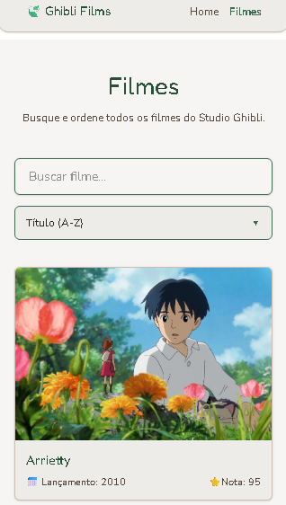

# 🎬 Visualizador de Filmes Ghibli

Catálogo interativo dos filmes do Studio Ghibli, consumindo a [Ghibli API](https://ghibliapi.vercel.app/). Desenvolvido como projeto de estudo, aplicando conceitos de rotas, hooks customizados, consumo de API, estados assíncronos e estilização com Tailwind CSS v4.

🔗 **[Acesse o projeto ao vivo](https://maiconcasagrandadev.github.io/visualizador-filmes-ghibli/)**

## 📸 Preview



## ✨ Funcionalidades

- Home com apresentação e os 3 filmes mais bem avaliados em destaque
- Página **Filmes** com a lista completa, busca por título e ordenação (título, nota ou ano)
- Página de detalhes com sinopse, data, nota, duração e ficha técnica (diretor e produtor)
- Loading state com skeleton animation
- Tratamento de erros de requisição e mensagem para buscas sem resultado
- Tema visual customizado (cores e tipografia inspiradas no universo Ghibli)
- Navegação com link ativo no Header e retorno ao topo ao trocar de página
- Totalmente responsivo (mobile, tablet e desktop)

## 🛠️ Tecnologias

- **React** + **TypeScript**
- **Vite**: build tool
- **React Router DOM**: rotas aninhadas com `Outlet`, `NavLink` e `useParams`
- **Tailwind CSS v4**: estilização utility-first, com tema customizado via `@theme`
- **Hooks customizados**: `useFilms` e `useFilm` isolam a lógica de fetch
- **Fredoka** e **Nunito**: tipografia
- **GitHub Pages**: deploy, com redirecionamento via `404.html` para as rotas da SPA funcionarem

## 🗂️ Estrutura do projeto

```text
src/
├── components/
│   ├── FilmCard/       # card reutilizável de filme
│   ├── Header/
│   ├── Footer/
│   └── ScrollToTop/    # volta ao topo ao trocar de rota
├── hooks/
│   ├── useFilms.ts     # busca a lista de filmes
│   └── useFilm.ts      # busca um filme por id
├── pages/
│   ├── Layout/         # estrutura compartilhada (Header + Outlet + Footer)
│   ├── Home/           # apresentação e filmes em destaque
│   ├── Films/          # busca, ordenação e lista completa
│   └── FilmDetails/    # detalhes de um filme específico
├── styles/
│   └── globals.css     # tema (cores, fontes)
└── types/
    └── Film.ts         # tipagem dos dados da API
```

## 🚀 Rodando localmente

```bash
# clonar o repositório
git clone https://github.com/MaiconCasagrandaDev/visualizador-filmes-ghibli.git

# entrar na pasta
cd visualizador-filmes-ghibli

# instalar dependências
npm install

# rodar em modo desenvolvimento
npm run dev
```

## 📦 Deploy

O projeto é publicado no GitHub Pages via `gh-pages`:

```bash
npm run deploy
```

## 🔜 Próximos passos

- Favoritos salvos no `localStorage`
- Dark mode

## 📄 Observação

Projeto para fins educacionais. Dados fornecidos pela [Studio Ghibli API](https://ghibliapi.vercel.app/).
